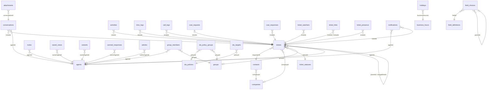

# Samadhan v7 — Phase 0 Discovery

Date: 2026-11-05 (IST). Branch: `feature/samadhan-v7` (from `origin/main` @ `4e8a551`).
Scope: read-only. No code, schema or data was changed. No database was connected to.

---

## 1. Where the code is (§C.1)

| What | Path | Notes |
|---|---|---|
| Samadhan frontend | `embedded-apps/setu/` | `package.json` name `setu`; Next.js 14.2.35 static export, basePath `/apps/setu` (`next.config.mjs`) |
| Samadhan backend | `backend/setu/` | Express router, `index.js` is the entry. ~8.2k lines |
| `backend/setu.js` | **does not exist** | The router is mounted inline from the shared `backend/server.js` lines 70–79 (`apiRouter.use('/setu', require('./setu'))`, with a 503 fallback if it fails to load) |
| Hub | `hub-next/` | Next.js static export, the site root; app tiles / Manage Access UI (see `RENAME-INVENTORY.md`) |
| Hub build script | `scripts/build-embedded-apps.js` | Builds **every folder** under `embedded-apps/` generically — no per-app entry. The folder name *is* the URL (`dist/apps/<folder>/`). It also **deletes untracked app folders** (lines 199–206): a rename must be committed before this script runs |
| Manage Access roles | `backend/server.js:165` | `VALID_ROLES_BY_APP['setu'] = ['Agent','Supervisor','Admin']` |
| CI | `.github/workflows/bom-cost-explorer.yml` only | Path-filtered to `embedded-apps/bom-cost-explorer/**`; never runs for Samadhan |
| Site deploy | `amplify.yml` (AWS Amplify) | Every push to `main` rebuilds the **hub site** (hub-next + all embedded apps) at dev.emamiapps.in. No backend deploy, no DB migration |
| Backend deploy | manual | `backend/setu/deploy/deploy-dev-server.sh` → PM2 `emami-hub-backend-dev` on 172.17.2.21 (dev). Prod `emami-hub-backend` (same box) is never touched by these scripts. `backend/lambda.js` + `scripts/deploy-lambdas.js` also package the backend as an AWS Lambda (hub-auth) |

## 2. Git (§C.2)

- `main` = default/integration branch. **No `dev` branch** exists (local or remote).
- Working tree was clean except the untracked prompt file `docs/SAMADHAN_MASTER_PROMPT_FINAL.md`.
- The previous Samadhan branch `setu/freshdesk-parity` is fully contained in `origin/main` (nothing lost by branching from main).
- `feature/samadhan-v7` created from `origin/main`; its upstream was unset so a bare `git push` can never target `main`.
- `git fetch` warns `cannot lock ref 'refs/remotes/origin/Feature/Animesh'` — a Windows case collision between remote branches `Feature/Animesh` and `feature/Animesh`. Unrelated to this work; harmless.
- Line endings: index LF, working tree CRLF (`core.autocrlf=true`); `backend/setu/deploy/.gitattributes` forces `*.sh` to LF.

## 3. Runtime and hosting

- **Backend**: shared Emami Apps Express backend (`backend/server.js`), Node (local v26.13.0; no `.nvmrc` / `engines`).
  Dev runs on PM2 at 172.17.2.21:4001 behind nginx at `https://audit-capa-api.emamiapps.in/dev-api/`; prod on the same
  public host without `/dev-api`. `lambda.js` exists for a Lambda/API-Gateway deployment of the hub auth part.
  The hostname (`emdcindpawebser`) suggests the Emami data centre, **not** AWS/Azure — **to confirm** (see questions).
- **Frontend**: static files served by AWS Amplify under `/apps/setu/` of the hub site.
- **Database**: shared Emami Apps PostgreSQL; Samadhan owns schema `setu`. Local `backend/.env` points at
  host `10.17.12.4`, database `Devhubfactory` (values read for host/db name only; password not read). **Not connected to** in Phase 0.
- **Local Postgres**: PostgreSQL 18.6 service running on `localhost:5432`, but it needs a password that is not configured for
  this Windows user (no `pgpass.conf`). Needed for the `samadhan_test` database (§C1) — see questions.
- **Mail**: Microsoft Graph via `backend/ccbTeams.js` (`graphToken`). Mailbox = `SETU_MAILBOX` (default `emami.helpdesk@emamigroup.com`).
- **AI**: Anthropic SDK (`backend/setu/lib/ai.js`), `ANTHROPIC_API_KEY`, `SETU_AI_ENABLED`; mock in `tests/mock-anthropic.js`.

## 4. Schema `setu` (version 6)

### 4.1 Migration mechanism

`backend/setu/db/schema.js`: `SCHEMA_VERSION = 6`. On every cold start `initSchema()` reads `setu.settings['schema.version']`;
if it differs it runs every `CREATE … IF NOT EXISTS`, then `upgradeV3()…upgradeV6()` (additive `ADD COLUMN IF NOT EXISTS`,
new tables, a few constraint swaps), then `seed()` (insert-if-missing), then stores the version. Every request awaits
`db/ready.js`. `db/install.sql` is the same schema + seed as one DBA script (refuses to run twice).

Gaps against §F.2: **no down scripts**, statements are **not in one transaction**, and the schema name `setu` is
**hard-coded in every SQL string** (821 lines in 37 files, no constant, no `search_path`; see `RENAME-INVENTORY.md` §3).
v7 must add a transactional up/down mechanism and a schema constant (PLAN.md §2).

### 4.2 Tables (41 + 1 sequence)

| Group | Tables |
|---|---|
| People | `agents`, `groups`, `group_members`, `companies`, `contacts` |
| Configuration | `ticket_statuses`, `field_definitions`, `field_choices`, `severity_rules`, `business_hours`, `holidays`, `sla_policies`, `sla_policy_groups`, `sla_targets`, `automation_rules`, `email_templates`, `scenarios`, `canned_responses`, `distributors`, `mr_mappings`, `settings`, `variants` |
| Tickets | `tickets` (+ `ticket_id_seq` START 100000), `conversations`, `attachments` (unused), `activities`, `time_logs`, `call_logs`, `csat_responses`, `csat_requests`, `ticket_watchers`, `ticket_links`, `ticket_presence` (UNLOGGED), `todos`, `saved_views` |
| Content / AI | `articles`, `ai_insights` |
| Ops | `audit_events`, `notifications` (bell), `mail_state`, `parked_mail` |

Columns are quoted camelCase (`"statusId"`, `"createdAt"`). Ids are `serial`/`integer` (tickets: `integer` from the sequence).

### 4.3 ERD (core)

Hub tables Samadhan reads/writes (schema `emami_apps`, owned by the hub, **shared**):
`authorized_user_apps` (grant + role, `app_id='setu'`; read on every request, written by Admin > Roles & access),
`authorized_users`, `users` (names), `access_history` (via `backend/accessHistory.js`, `app_id='setu'`),
`notifications` (hub inbox via `backend/notifications.js`, `app_id='setu'`, `link='/apps/setu/?ticket=<id>'`, `ref_key='setu:<id>:<template>'`).

### 4.4 How fields map to columns

- `field_definitions.key` **is** the `tickets` column name (camelCase). 19 seeded fields:
  `callSubject, region, distributorCode, distributorName, salesOrg, state, depot, asmName, depotCoordinator, mrUid,
  mobileNo, alternateMobileNo, callerName, callerContactNumber, type, category (type nested), l2Agent, helpdeskAnalysis, rcaSolution`.
- Types: `text | number | dropdown | nested | paragraph` (CHECK constraint). `required` = required **before resolve**
  (`lib/ticketOps.assertResolvable`); for `category` both category and function must be set.
- Editable whitelist: `constants.EDITABLE_FIELDS` (the 19 field columns + `function`) and `PATCHABLE` (+ subject, statusId,
  priority, groupId, agentId, tags). Mirrored in the frontend `src/lib/types.ts` `EDITABLE_FIELDS`.
- `CREATE_FIELDS` in `lib/tickets.js` adds `groupId, agentId, priority, tags`.

### 4.5 Choices, category tree, severity, SLA

- **Choices**: `field_choices(fieldId, parentId, value, position, active)`. Flat dropdowns have `parentId NULL`.
- **Category tree**: choices of field `category`; top level = Category (`parentId NULL`), children = Function. `/meta`
  returns it as `categoryTree`. No workspace column today (global).
- **Severity**: `severity_rules(category, function, severity)` with `function='*'` wildcard; anything unmatched = `NORMAL`.
  Seeded only FATAL rows (9); SERIOUS maintained in Admin. Severity → priority via setting `severity.priority`
  (default FATAL 4 / SERIOUS 3 / NORMAL 1). Category/function change recomputes severity and priority unless priority is set in the same patch.
- **SLA**: `sla_policies` → `sla_targets` (per priority 1–4: first response, next response, resolution minutes, businessHours flag)
  → `sla_policy_groups`. Target = first policy (by position) linked to the ticket's group, else the `isDefault` policy.
  Due dates from `createdAt` + target + `slaPausedMins`; statuses with `pausesSla` pause the clock. Business calendar =
  first `business_hours` row (Asia/Kolkata, Mon–Sat 09:00–20:00) + `holidays`. Cached 60 s, cleared on Admin edits.
- **Statuses**: core ids 2 Open, 4 Resolved, 5 Closed; seeded 3, 8, 9, 11–15; custom ids ≥ 100 (Admin > Statuses).
- **Round robin**: `lib/assignment.js`, group row lock, Available agents only.
- **Automations**: `automation_rules(trigger ON_CREATE|ON_UPDATE|TIME, conditions {all,any}, actions[])`; actions
  `setStatus, setPriority, setGroup, setField, sendReplyTemplate, markEscalated, notifyAgents`. TIME rules evaluated in the 5-min job.

## 5. Mail ingest and threading token

- `lib/mailIngest.js`: Graph delta query on the inbox (≤ 50 pages), then per message `processMessage()`; a failure parks that
  message (`intake_error`) and continues. Marks the message read.
- **Threading token parser** — `lib/mail.js ticketNumberFromSubject()`, first match wins:
  1. `\[#(\d{5,9})\]` → `[#100123]` (used by agent replies/forwards: `Re: <subject> [#<id>]`, agent notifications)
  2. `\|\|\s*(\d{5,9})\b` → `|| 100123` (acknowledgement subject `Ticket Received - <subject> || <id>`)
  3. `TICKET No\s*-\s*(\d{5,9})\b` (i) → `#TICKET No - 100123` (reply signature body/subject)
  Numbers above 2147483647 are ignored. A merged ticket's number resolves to its primary.
- **Safe place for the `APPCODE-id` reference**: a token like `MSFA-100123` does **not** match any of the three patterns
  (pattern 1 needs `[#` directly before digits; 2 needs `||`; 3 needs `TICKET No -`). So the reference can be added as a
  **prefix before the existing token**, e.g. `Re: <subject> [MSFA-100123] [#100123]`, without changing threading — as long
  as the `[#<id>]` token stays. Unit tests will lock this (TEST-PLAN §B.3).
- Thread guard: only the requester or someone already on the thread may add; SPF/DKIM/DMARC failure → parked; > 20 new
  tickets/hour per sender → parked; noise (auto-replies, OOF, own notifications, `^ticket received -`) → parked.
- **Inbound attachments are not stored**: `hasAttachments` is selected but never read; inline `cid:` images stay broken links.

## 6. Access (roles) today

- `middleware/auth.js requireAccess`: verifies the hub JWT (HS256, `HUB_AUTH_JWT_SECRET`, rejects purpose-bound tokens),
  reads the `setu` grant from `emami_apps.authorized_user_apps`, upserts `setu.agents` with that role (unknown roles → Agent),
  refuses deactivated agents (403). Role is re-read from the grant on **every** request (no cache).
- Server checks: `isSupervisor` (Supervisor|Admin), `isAdmin`, `requireSupervisor`; Admin router guarded at `routes/admin.js:17`.
- Route → role baseline (to be reproduced exactly by the seeded AGENT/SUPERVISOR/ADMIN profiles):

| Route(s) | Agent | Supervisor | Admin |
|---|---|---|---|
| `/me`, `/me/*`, `/meta`, `/notifications*`, `/contacts/search`, `/distributors/lookup` | ✔ | ✔ | ✔ |
| `/tickets` list/counts/get/create/patch, `/tickets/bulk` (except purge), merge, links, watch, scenarios, presence, messages, time-logs, calls | ✔ | ✔ | ✔ |
| `/tickets/bulk` action `purge` | ✖ 403 | ✖ 403 | ✔ |
| `/tickets/export` | ✖ 403 | ✔ | ✔ |
| `/tickets/export/columns` | ✔ | ✔ | ✔ |
| `/board`, `/dashboard`, `/dashboard/overview`, `/dashboard/breakdown` | ✔ | ✔ | ✔ |
| `/analytics`, `/reports/daily` | ✖ 403 | ✔ | ✔ |
| `/insights/dashboard` (`?refresh=1` honoured only for Sup/Admin), `/tickets/:id/insights` | ✔ | ✔ | ✔ |
| `/todos*`, `/views` (sharing: Sup/Admin), `/variants` (sharing: Sup/Admin; delete others': Admin) | ✔ | ✔ | ✔ |
| `/search` (draft articles visible to Sup/Admin), `/contacts*`, `/companies` GET | ✔ | ✔ | ✔ |
| `/companies` POST, `/articles` POST/DELETE | ✖ | ✔ | ✔ |
| `/articles` GET (drafts: Sup/Admin only), feedback | ✔ | ✔ | ✔ |
| `/admin/*` (39 routes) | ✖ 403 | ✖ 403 | ✔ |
| `POST /jobs/run` | Admin session or `x-internal-secret` | | ✔ |
| `/portal/*`, `/whatsapp/webhook` | public (own limits) | | |

- Frontend: `NAV` `show: s.sup` for Analytics, Daily report; `s.admin` for Admin. 31 `isSupervisor`/`isAdmin` uses in
  `components/` + `lib/context.ts` (Tickets 9, App 6, Contacts 5, Solutions 4, Reports 3, Analytics 2, Insights 2).
  There is **no screen guard**: `go('admin')` from a deep link or state is only prevented by the nav being hidden
  (the API still returns 403). §N.1 closes this.

## 7. Storage

- **No object storage exists** in the shared backend: no S3 / Azure Blob SDK in `backend/package.json`, no presign code.
  Other apps store uploads on local disk (`audit-capa` multer → `/uploads`) or in memory (`rc-portal`). The unused
  `setu.attachments` table has a `storageKey` column but nothing writes it.
- §L says: *if no object storage exists, STOP and propose options; do not store files in Postgres*. → **Blocker for
  Phase 2 attachments; options in PLAN.md §6 and a question at this STOP.**

## 8. Jobs, SLA checks, insights, portal, WhatsApp

- `lib/jobs.js runJobs()`: Postgres advisory lock `hashtext('setu.scheduled_jobs')` + `jobs.lastRunAt`; runs mail ingest,
  SLA reminders/violations, TIME automations, bell purge (30 days). Triggered every 5 min by `setInterval`, by normal
  traffic (`jobsDue()`), or `POST /api/setu/jobs/run` (Admin / `x-internal-secret`).
- Insights: rules + optional Claude (`claude-opus-5-5`), cached in `setu.ai_insights`; personal data masked.
- Portal (`routes/public.js`): `/portal/config|tickets|status|articles|csat/:token`; honeypot; per-IP / per-email / global caps.
  CSAT links: `${APP_URL}/apps/setu/portal/?csat=<token>` (in emails already sent). Portal header text lives in
  `components/Portal.tsx`.
- WhatsApp: `GET/POST /api/setu/whatsapp/webhook`, `X-Hub-Signature-256` over the raw body; the URL is configured in Meta.

## 9. Current values

- **Sources** (`constants.SOURCES`): Email, Phone, Portal, WhatsApp, Chat, Internal + `settings['sources.extra']` (Admin).
- **Type** (seeded `field_choices`, same as the Freshdesk extract `TICKET_TYPES`): Rural mSFA, Wrong ticket, CDMS, mSFA,
  SalesCode DMS, SalesCode SFA, Salescode B2B App, SalesCode Supervisor App, SalesCode Portal, SalesCode Manager App.
- **Region**: EAST, WEST, NORTH, SOUTH, Wrong Ticket, ALL REGIONS. **Sales Org**: EM01 - CCD, EM02 - HCD, Wrong Ticket, ALL.
- **Category tree**: Admin-maintained in the DB; the reference copy is the Freshdesk set-up in the PulseDesk extract
  (`D:\downloads\pulsedesk-ver1\src\lib\config.ts`, loaded by `deploy/demo/load-pulsedesk.js`). 43 categories:

| Category | Functions |
|---|---|
| E Invoice | IRN Not generated; QR code not showing; Seller address is blank; Syntax error; New Requirement; DMS; Application |
| TCS | — |
| CDMS - Login Issue | CDMS - Login Issue |
| Service Invoice | Cancel Service Invoice; Unable to create |
| mSecSales Application - Sync Issue | Multiple Device Sync issue(PAN INDIA); Multiple Device Sync issue(Branch / Region); Single Device Sync Issue; OTP Issue |
| mSecSales Device Issue- Hang/Hold | Device Getting Hang |
| mSecSales Configuration Issues | Device Configuration - New / Change Replacement / Reinstallation; mSecSales App Not Opening; SAP mobile Secure Configuration |
| mSecSales Application - Day Start/Day End | Day Start Related Issues; Day End Related Issues; Day Start' icon not appearing after 'Day End' |
| mSecSales Application - My Targets | KPI data not reflecting; Wrong KPI data reflecting |
| mSecSales Application - Db Stock | DB Stock mismatching |
| mSecSales Application - Behaviour | Behaviour data related issues |
| mSecSales Application - Day Summary | Day Summary data related issues |
| mSecSales Application - Visual aid | Visual Aid files not opening |
| mSecSales Application - Beat Work | Not able to communicate with Retailer; Merchendising Related issue; Sales Order - Outlets not visible |
| mSecSales Application - Master | Customer / Product / Beat / Promotion Master Related issue |
| Device Settings | Internet Connectivity Related Issue; Date/Time related Issue |
| mSecSales Application - Version | version upgrade issue; Issue in mSecSales App post version upgrade |
| mSecSales Asset Missing /Stolen Issues | Charger Lost; Device -Lost/New; Device -Damage; USB Cable issue; Device Malfunction; Device battery issue |
| mSecSales-End User Understanding & Handholding | HH-End User Understanding & Handholding |
| mSecSales Application - Login Screen | Login / Password Related issue |
| Rollout | Rollout Related Issues |
| Masters | Add New Retailer; Modify Retailer; Need to Active old MR; Inactive MR to New MR Outlet Transfer; Outlet transfer to Beat (*partial: 18 in Freshdesk*) |
| Inventory | Create / View-Download Stock Adjustment (*partial: 10*) |
| Secondary Sales | Create Sales Order; View/Edit Sales Order (*partial: 15*) |
| mSFA Reports | View/Download Competitor / Complaints Report (*partial: 13*) |
| CDMS Reports | View/Download Billed Customer / Custom Report (*partial: 9*) |
| Feedback | Create Feedback; View Feedback List |
| Alert | Create Alert; View Alert |
| Finance | Create / View Credit Note (*partial: 6*) |
| Schemes & Claims | Check Claim Reconciliation; Scheme Claims; Scheme |
| Purchase | Create GR; View GR (*partial: 10*) |
| Application | Application Server Down; One/Few modules not working |
| User Management | User Account Locked; User has forgot password; New User Creation |
| Proactive | Proactive Activity |
| CDMS-End User Understanding & Handholding | CS-End User Understanding & Handholding |
| MR Expense | MR Expense Create; MR Expense View/Edit |
| CDMS Purchase Issue | Purchase Issue |
| Printer | Printer Settings; Print Allignment |
| Rural mSFA - Retailer Creation | Rural mSFA - Retailer OTP |
| Wrong Ticket | Wrong Ticket |
| Loyalty Issue | Loyalty Issue; Loyalty scheme expired |
| New Requirement | — |
| FSSAI No | Update/Change; Maintain |
| SalesCode | — |

The live dev DB may hold more (Admin edits, the full "partial" lists). The exact live tree and the per-type/category
ticket counts need a read-only query on the dev DB — pending your approval (see questions).

### 9.1 Overlap with the §O "Sales Apps" sub-categories

| §O proposed | Existing equivalent | Proposal |
|---|---|---|
| Login / OTP | mSecSales Application - Login Screen; CDMS - Login Issue; Sync Issue › OTP Issue; Rural mSFA - Retailer OTP | **skip** (exists) |
| Sync / Data Upload | mSecSales Application - Sync Issue | **skip** |
| Order Booking | Secondary Sales › Create Sales Order; Beat Work › Sales Order - Outlets not visible | **skip** |
| Scheme / Discount | Schemes & Claims | **skip** |
| Beat / Route Plan | Beat Work; Master › Beat Master | **skip** |
| Attendance / GPS | Day Start/Day End (partial) | **add** (GPS has no equivalent) |
| Outlet / Retailer Master | Masters › Add/Modify Retailer | **skip** |
| Stock / Inventory | Inventory; Db Stock | **skip** |
| Claims | Schemes & Claims | **skip** |
| Reports / Dashboard | mSFA Reports; CDMS Reports; My Targets | **skip** |
| App Crash / Performance | Device Issue- Hang/Hold; Configuration › App Not Opening | **add** (crash/performance as such is missing) |
| Device / Version | Device Settings; Application - Version; Asset Missing | **skip** |

So only **Attendance / GPS** and **App Crash / Performance** would be appended (to be confirmed with the live tree).

## 10. Frontend facts

- No lint script / ESLint config in the frontend (only `typecheck` = `tsc --noEmit` and `build`). The backend has no lint either.
  §T.0 asks for lint: PLAN proposes ESLint as a **frontend-only devDependency** and `node --check` for backend files.
- Existing tests: `backend/setu/tests/unit.test.js` (no DB), `api.test.js` (HTTP suite against a local throwaway DB,
  guarded by `SETU_TEST_ALLOW=1` + localhost URLs), `mock-anthropic.js`. Not wired into `backend/package.json` (`npm test`
  runs only `backend/test/*.test.js` = other modules' tests). No Playwright / E2E.
- API base: `NEXT_PUBLIC_SETU_API_URL` else `https://audit-capa-api.emamiapps.in[/dev-api]/api` (`/dev-api` when the host contains `dev`).
- Local storage keys: hub keys `emami_apps_session_token`, `emami_apps_user_email`; Samadhan-own keys listed in `RENAME-INVENTORY.md`.
